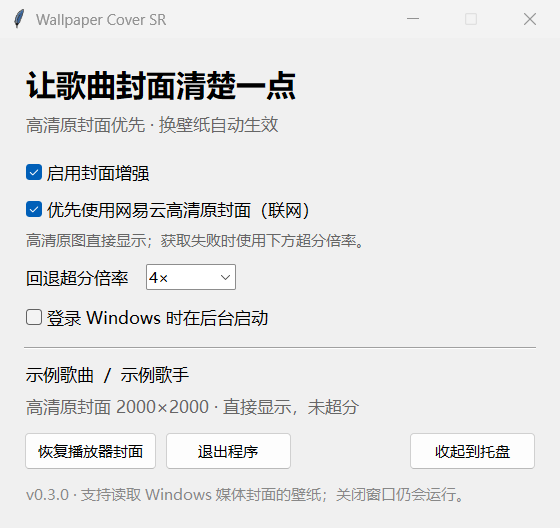

  
  <h1>Wallpaper Cover SR</h1>
  
<strong>让壁纸里的歌曲封面，清晰如初。</strong>

  
网易云高清原封面优先 · Wallpaper Engine 通用媒体接入 · 按需超分

  

    
    
  

  
<a href="#下载安装">下载安装</a> · <a href="#如何使用">如何使用</a> · <a href="#如何卸载">如何卸载</a> · <a href="#常见问题">常见问题</a>

---

壁纸能显示正在播放的歌，封面却常常只是低清缩略图。Wallpaper Cover SR 会优先取得网易云的**高清原封面并直接显示**；无法获取时，再使用官方 **Real-ESRGAN NCNN/Vulkan** 处理系统缩略图。

它通过 Windows 标准媒体会话把封面交给壁纸。换用同类壁纸时，无需重新适配。

| 高清原图优先 | 通用媒体接入 | 轻量后台体验 |
| --- | --- | --- |
| 核对歌曲与封面后使用官方高清原图，保留真实文字和画面细节。 | 面向读取 Windows 当前媒体封面的场景壁纸，保留原有封面效果。 | 常驻托盘；高清模式无需 AI 推理，回退超分完成后释放 GPU。 |

  
  
实际界面截图，歌曲信息为示例。当前版本 v0.3.0。

## 下载安装

**系统要求：Windows 10/11 x64、Wallpaper Engine 和可提供 Windows 媒体信息的音乐播放器。** 超分回退需要支持 Vulkan 的显卡驱动。高清取图已在网易云 Windows 3.1.41.205529 验证。

1. 打开 [最新版本下载页](https://github.com/panjiangle/WallpaperCoverSR/releases/latest)。
2. 在 **Assets** 下载 `WallpaperCoverSR-0.3.0-windows-x64.zip`，约 **61 MB**。普通用户无需下载 Source code 或源码包。
3. **完整解压**到一个固定文件夹，例如 `D:\Apps\WallpaperCoverSR`。
4. 打开解压后的 `WallpaperCoverSR.exe`。

**请保留整个文件夹，包括 `_internal`、`vendor` 和 `licenses`；不要只复制 exe，也不要直接在压缩包内运行。** 无需安装 Python、CUDA 或登录网易云账号。下载页提供 SHA256 文件；当前发行包未进行代码签名。

## 如何使用

1. 启动 Wallpaper Engine，应用一张原本就能显示当前歌曲封面的壁纸。
2. 打开网易云并播放音乐。
3. 在工具中开启 **启用封面增强** 和 **优先使用网易云高清原封面（联网）**。
4. 状态出现 **“高清原封面 … · 直接显示，未超分”** 时，壁纸已经使用高清原图。

| 设置 | 作用 |
| --- | --- |
| 启用封面增强 | 总开关。关闭后恢复播放器原有的系统封面。 |
| 优先使用网易云高清原封面（联网） | 从本地播放队列取得官方图片地址，核对后直接显示高清原图。关闭则使用离线超分。 |
| 回退超分倍率 | 仅在没有可用高清原图时生效，支持 2× / 3× / 4×。 |
| 登录 Windows 时在后台启动 | 登录后只显示托盘图标。Wallpaper Engine 的自启动在其自身设置中开启。 |
| 恢复播放器封面 | 关闭增强显示，不修改壁纸文件。 |

关闭设置窗口会收起到托盘；**双击托盘图标**或再次运行程序可重新打开。要停止后台服务，请在界面或托盘中选择 **退出**。

### 换壁纸与兼容范围

读取 **Windows 当前媒体封面** 的场景壁纸可以沿用这套接入，无需指定壁纸目录。已通过真实渲染验证的创意工坊项目：`3571726810`、`3395777145`，包括当前/上一张封面的混合效果。

如果壁纸固定只读取 `cloudmusic.exe`，请改为自动来源或允许 `WallpaperCoverSR`。直接从网站抓图、自带播放器或固定图片的壁纸不经过同一接口；网页壁纸尚未完成实机兼容验证。

高清获取依赖网易云本地队列格式。其他版本、商店版或其他播放器不保证能获取高清原图，无法可靠匹配时会回退。程序的 Windows 媒体桥接与高清图片来源是两个独立环节。

## 如何升级

1. 从托盘退出旧版。
2. 下载并完整解压新版，放到原来的程序位置。
3. 再次运行程序。设置和缓存保存在用户数据目录，通常无需重新配置。

如果改放到其他目录，请先在旧版取消开机启动，再在新版重新开启。0.1 用户应应用创意工坊原壁纸；旧版增强副本不再需要。

## 如何卸载

便携版没有安装器，也不会出现在系统的“已安装的应用”列表中。

1. 在设置窗口**取消勾选“登录 Windows 时在后台启动”**。
2. 点击 **退出程序**，或从托盘菜单选择 **退出**。
3. 删除完整的 `WallpaperCoverSR` 程序文件夹。
4. 如需清除设置、日志和缓存，按 **Win + R**，输入 `%LOCALAPPDATA%\WallpaperCoverSR`，打开后删除该数据文件夹。

退出后 Windows 会移除本工具的媒体会话，壁纸继续读取真实播放器。**无需重新安装网易云或 Wallpaper Engine，也无需改动创意工坊壁纸。**

## 常见问题

<strong>为什么高清模式没有进行超分？</strong>

高清原图包含真实笔画与纹理，通常比从缩略图重建更可靠。最长边超过1024像素时会缩到1024发布，不进行 AI 重建或额外锐化；倍率只用于回退超分。

<strong>为什么有时会回退到超分？</strong>

可能没有对应本地队列、客户端格式变化、网络不可用，或同名版本/封面图像无法可靠核对。程序宁可使用系统封面，也不会按相近歌名猜图。支持联网时会有条件重试。

<strong>会上传听歌记录或需要账号吗？</strong>

无需账号、密码或 cookie。高清模式只读本地队列，向网易云官方图片 CDN 请求封面；不向搜索服务发送歌名，不上传缩略图或遥测。关闭高清选项后使用离线超分路径。

<strong>Windows 媒体面板为什么多了一个会话？</strong>

`WallpaperCoverSR` 用来提供清晰封面，歌名、歌手和状态跟随真实播放器。标准媒体控制请求会转发给原播放器，程序不会播放音频。其他读取“当前系统媒体”的软件也可能看到这个会话。

<strong>后台占用如何？</strong>

高清原图命中缓存时无需联网，也无需启动 AI 推理。超分只在新低清封面且未命中缓存时运行，处理后退出。0.3 本机短样本工作集约91 MiB；该数据不是所有硬件的保证。具体环境和验证边界见 [VALIDATION.md](VALIDATION.md)。

## 开发与贡献

项目使用 Python 3.13 x64、Tk/pystray、PyWinRT 与官方 Real-ESRGAN NCNN 后端。代码与原壁纸解耦，不包含音乐封面、壁纸素材、账户信息或本地缓存。

- [技术说明与从源码构建](docs/technical.md)
- [实测与兼容边界](VALIDATION.md)
- [问题反馈](https://github.com/panjiangle/WallpaperCoverSR/issues)
- [第三方组件与许可](THIRD_PARTY_NOTICES.md)

欢迎提交可复现的问题和改进。反馈时可提供客户端版本、壁纸编号和错误状态；分享日志前请自行检查其中的曲目信息。

---

程序代码采用 [MIT](LICENSE)。Real-ESRGAN 和其他依赖保留各自许可证；音乐封面及壁纸属于原作者，不随项目分发。
